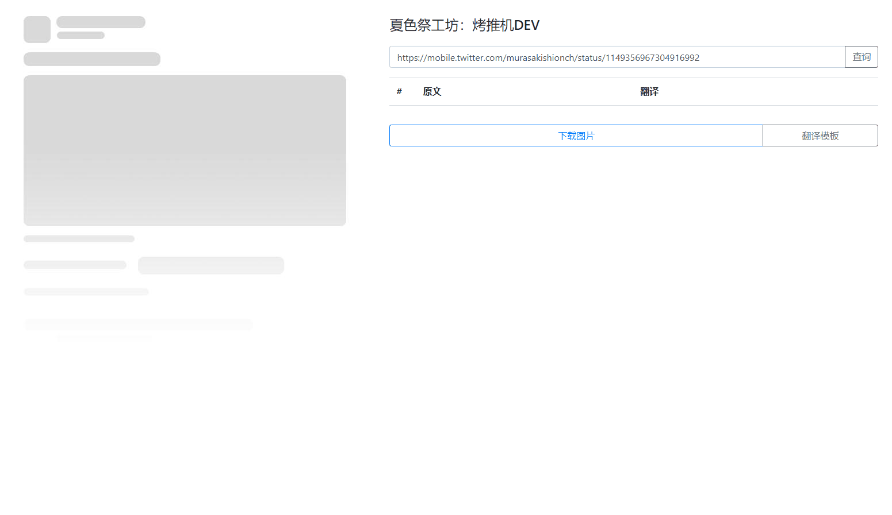
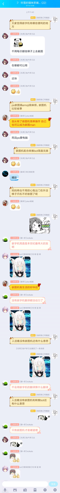

# TweetToaster

[中文](README.md) | English

<p align="center">
  
</p>

Create shareable images of public X/Twitter posts with your own translations and your group's logo. TweetToaster handles the layout so you do not have to recreate the same image in an editor every time. It is a typesetting tool, not an automatic translation service.

Originally created by 夏色祭工坊 (Natsuiro Matsuri Workshop), with thanks to:

- [FzXiao](https://github.com/fzxiao233) · [Bilibili](https://space.bilibili.com/2387011)
- [飞雪 / Wudifeixue](https://github.com/wudifeixue) · [Bilibili](http://space.bilibili.com/739848)
- [鱼鱼 / Yuyuyzl](https://github.com/yuyuyzl) · [Bilibili](https://space.bilibili.com/1534590)

## Features

- Switch between **EN / 中文**. The first visit uses the first supported language in your browser preferences, or English if none matches. Your manual choice is remembered; switching languages does not rewrite your translations, logos or template content.
- Query a profile using `7216_2nd`, `@7216_2nd` or `x.com/7216_2nd`, or paste a specific `x.com/.../status/...` or `twitter.com/.../status/...` link. The `https://` prefix is optional.
- Profile queries show recent posts **authored by that account**, not other authors' posts that the account reposted. Quotes remain inside the author's own post. The first three results are selected by default; you can change the selection.
- Specific-post queries include available thread context and replies from other users. Select and translate each item independently.
- On phones, switch between editing and preview. On larger screens, compare them side by side. Long previews fit the screen without changing the exported image's dimensions.
- Search the bundled [toastTemplates](https://github.com/cn-matsuri/toastTemplates) library, with 49 visible templates. Only your favorites appear in the everyday dropdown.
- Save favorite templates, your last selection, uploaded logos, advanced HTML drafts and named templates in your browser.
- Logos retain their original proportions and CSS-pixel dimensions. They shrink only when necessary to fit the 568px content area.
- Preview and export share the same card layout. PNGs are rendered server-side in Chromium at 640 CSS pixels wide with a 2× scale, producing 1280-pixel-wide images.
- Exported timestamps use the preview's browser timezone, including date changes and daylight saving time, rather than the server's timezone.
- Browser exports use a short-lived snapshot of the queried posts, so an updated timeline does not remove selected posts during download.
- The legacy asynchronous Bot API remains supported.
- Uses the free public FxTwitter/FxEmbed API by default. No paid X API or API key is required; a self-hosted provider can be configured.

## Deploy a prebuilt image

GitHub Actions publishes container images to GHCR. You do not need to build the project on your server:

```bash
docker run -d \
  --name tweettoaster \
  --restart unless-stopped \
  --shm-size=512m \
  -p 127.0.0.1:8082:8082 \
  -v tweet-cache:/app/Matsuri_translation/frontend/cache \
  ghcr.io/cn-matsuri/tweettoaster:latest
```

Alternatively, use the repository's `compose.yaml`, which also pulls the prebuilt image:

```bash
docker compose pull
docker compose up -d
curl http://127.0.0.1:8082/api/health
```

The image supports **`linux/amd64` and `linux/arm64`**. It runs on Linux Docker and on Docker Desktop for macOS or Windows. It is a Linux container, not a native Windows container.

Same-repository pull requests publish a `pr-<number>` test image. Merges to `master` publish `latest`; version tags publish matching image tags. With Compose, set `TWEETTOASTER_TAG` to select a different tag.

For public hosting, use a reverse proxy such as Nginx or Caddy to forward your domain to `127.0.0.1:8082`. The examples bind the host port to loopback so it is not exposed directly alongside the proxy.

### Environment variables

| Variable | Default | Purpose |
| --- | --- | --- |
| `PORT` | `8082` | HTTP port |
| `HOST` | `0.0.0.0` | Listen address |
| `CHROMIUM_PATH` | Auto-detected | Chromium executable for PNG export; configured in the image |
| `TWEET_PROVIDER_URL` | `https://api.fxtwitter.com/2` | Free provider's API root; can point to a self-hosted FxEmbed instance |
| `TWEET_PROVIDER_TIMEOUT_MS` | `15000` | Provider timeout in milliseconds |
| `TWEET_TIMELINE_COUNT` | `12` | Maximum authored posts per profile query, from 1 to 20; filtering reposts can leave fewer results, without automatic pagination |
| `TWEET_REPLY_COUNT` | `20` | Maximum replies for a specific post, from 0 to 30 |
| `TEMPLATE_ALLOWED_HOSTS` | `x.wudifeixue.com,raw.githubusercontent.com` | Allowed hosts for remote Bot templates |

## Bot API

Create a render job:

```http
POST /api/auto
Content-Type: application/json

{
  "tweet": "https://x.com/user/status/123",
  "translate": "Your translation",
  "template": "/template/matsuri.txt",
  "noLikes": false,
  "logo": "official",
  "language": "en"
}
```

The response is `200 {"task_id":"..."}`. Poll `GET /api/get_task=<task_id>`. When `state` is `SUCCESS`, `result` is the image's basename; download it from `/cache/<result>.png`.

Jobs have a **45-second deadline from submission**, including queueing, fetching posts and templates, and rendering. A timeout returns `state: "FAILURE"` and `code: "JOB_TIMEOUT"`, with a readable error in `error` / `result`. Stop polling on either `SUCCESS` or `FAILURE`. An unknown or expired task returns `FAILURE` / `JOB_NOT_FOUND`, rather than remaining pending forever.

Each process admits at most 50 jobs whose work has not yet been cleaned up. Chromium renders one job at a time; new jobs receive `503 QUEUE_FULL` when capacity is exhausted. Cancellation aborts network requests, removes queued rendering work and terminates a stuck browser process. A capacity slot is released only after actual cleanup finishes.

Up to 500 task records are held in memory. Completed records normally remain available for one hour after completion, but capacity pressure may evict them sooner. Task records do not survive a server restart; submit a new job if necessary.

The legacy multi-post translation format remains supported:

```text
##1
Translation for the first post
##2
Translation for the second post
```

The `tweet` field also accepts profile links and usernames. The `template` field may be empty, inline HTML, a local path such as `/template/matsuri.txt`, or an HTTPS URL on an allowed host. Remote templates are limited to 64 KB, and private network addresses are rejected.

Bots may pass `timeZone`, such as `Asia/Shanghai`, `Asia/Tokyo` or `America/New_York`. Omitting it preserves the legacy server-default timezone behavior. Browser exports send the preview's timezone automatically. Invalid timezones return `400 INVALID_TIME_ZONE`.

The optional `language` field accepts `"en"` or `"zh"` and controls the image's labels and date/count formatting. It defaults to `"zh"` for compatibility with existing Bots. Browser exports use the selected interface language. Language and timezone are separate settings: changing language does not change the post's time or translate its text.

### Stable browser exports

`POST /api/tweet` returns a `snapshotId`; the browser includes it in `POST /api/render` so the exported text, counts and selections use the same data as the preview, without fetching the timeline again.

Snapshots contain only public post data, not translations or custom logos. They are stored in memory with limits of 100 entries, 32 MiB and 30 minutes, and are lost on restart. Expired or evicted snapshots return `409 SNAPSHOT_EXPIRED`; the editor keeps your text, so copy your translations before querying again. Clients that omit `snapshotId` remain compatible. Missing selected posts produce an explicit error instead of silently exporting fewer posts.

### Template compatibility

The maintained [toastTemplates](https://github.com/cn-matsuri/toastTemplates) library is bundled with the application and container image; it does not need a separate clone on the server. Legacy `/template/*.txt`, `/templates/*.txt`, `?template=/template/*.txt` links and multi-style template comments remain supported.

Maintainers can run `pnpm templates:sync` to regenerate the bundled library from the local template source. An explicit source directory can be passed with `pnpm templates:sync /path/to/template-source`. The generated library excludes the obsolete 25 MB remote font.

## Personal templates and logos

Open the template/logo library, search for a group or template, and add it to your favorites to include it in the dropdown. Uploaded logos and saved HTML templates are also added to your favorites and stored in the browser's IndexedDB.

- Custom logos support PNG, JPEG and WebP. Their original size and aspect ratio are preserved, subject to the card's available width.
- Locally stored assets have no 50 KB product limit; available storage depends on the browser's quota. There is no server-side personal asset library or account synchronization.
- During PNG export, the selected logo is temporarily sent to the same TweetToaster server for rendering. It is not retained as a reusable uploaded asset, although it appears in the generated PNG. Temporary logo render data is limited to 32 MB to protect the service from oversized requests.
- If persistent server-side logo storage is added in the future, it should enforce a separate 50 KB limit; that feature is not present in this version.
- Advanced HTML templates must contain `{T}`, the translation placeholder. Drafts are saved automatically, and multiple named templates can be saved. Unsafe tags, event handlers and remote resources are removed before rendering.

Browser-local preferences and assets belong to that browser profile. Clearing site data removes them; they are not synchronized to another device.

## Local development and tests

Install Node.js 22+ and Chrome/Chromium:

```bash
corepack enable
pnpm install
pnpm test
pnpm start
```

Open [localhost:8082](http://localhost:8082). Set `CHROMIUM_PATH` if Chromium cannot be found automatically.

Tests against the live free provider run separately:

```bash
pnpm test:live
```

For mobile layouts and language switching in Playwright WebKit:

```bash
node node_modules/playwright-core/cli.js install webkit
pnpm test:webkit
```

WebKit is the engine used by Safari. These automated engine tests are separate from testing Safari on a physical iPhone or iPad; the server still uses Chromium to create PNGs.

Pull requests run unit tests, browser/export regressions, a production dependency audit, and amd64/arm64 image builds. Template tests render all 51 template entries, checking image loading, original dimensions, aspect ratios and overflow within the 640px card layout. Other tests cover browser-local logos larger than 2 MB, template persistence after reload, profile authorship, selected replies, font sizes, timezones and daylight saving transitions.

Job lifecycle regressions cover queue capacity, real resource cleanup after timeout, stalled response bodies, recovery from stuck browser rendering, preventing late PNGs after cancellation, and legacy Bot failure polling.

## Data source and costs

TweetToaster uses the free public [FxEmbed/FxTwitter](https://github.com/FxEmbed/FxEmbed) API by default. It does not require an API key or integrate with a paid X API. Public endpoints may change their rate limits or availability. A self-hosted FxEmbed instance can be selected through `TWEET_PROVIDER_URL` without changing TweetToaster's code.

---

## Project history

The original project links and community memories are preserved here and in the [Chinese README](README.md).



### Launch article / Blog

[庆贺吧，这是集数码暴龙与嵌字 man 力量于一身的烤推机](https://www.bilibili.com/read/cv3081959) — the original launch article, in Chinese.

The original workflow was to paste a permanent tweet link, fetch the post, enter a translation and download the resulting image. Templates could be customized with HTML.

Template source: [cn-matsuri/toastTemplates](https://github.com/cn-matsuri/toastTemplates).

### Community testimonial


